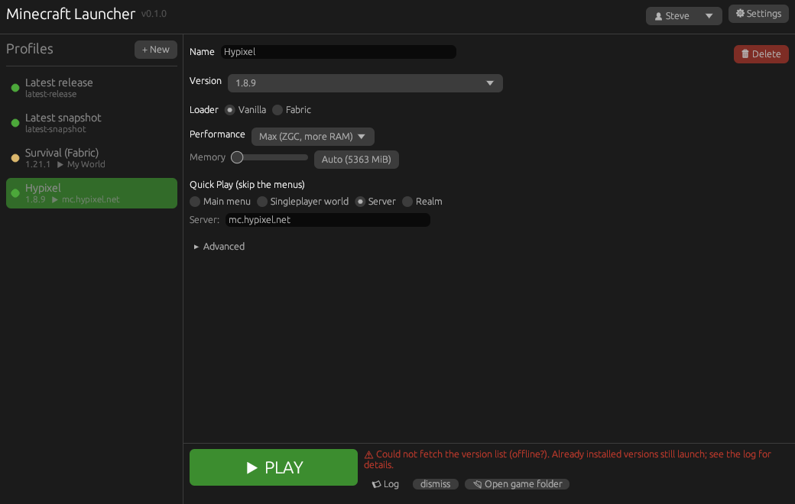

# Minecraft Launcher

A fast, open-source port of the Minecraft Launcher, written in Rust.



It uses the same `.minecraft` folder and the same `launcher_profiles.json` as
the official launcher, so your worlds, servers, resource packs and profiles
are picked up unchanged. Switching back is a one-click affair.

## What it does

- **Opens instantly.** A native window, no web view. First frame is drawn in a
  few milliseconds; the version list comes from a disk cache and refreshes in
  the background.
- **Starts the game in well under a second.** Once a version is installed, a
  launch only compares file sizes (no re-hashing), builds the command line and
  starts Java. In the test suite a warm launch takes about 100 ms, a cold
  install-and-launch of a small version about 300 ms (excluding downloads).
- **Smooth frame rate.** Every profile has a performance preset:
  - *Smooth* (default): fixed heap, low-pause G1 tuning, automatic memory
    sizing based on your RAM, JVM class-data-sharing archive for faster JVM
    start-up.
  - *Max*: generational ZGC on Java 21+ for the fewest stutters, bigger heap.
  - *Vanilla*: exactly what the official launcher passes.
- **Performance pack.** Pick *Fabric* for a profile and the launcher installs
  Fabric loader plus a curated set of client-side performance mods from
  Modrinth: Sodium, Lithium, FerriteCore, ImmediatelyFast, Entity Culling,
  ModernFix, Dynamic FPS, Krypton and C2ME. These are what make a big
  difference: higher and steadier FPS, much faster game start-up (ModernFix),
  faster chunk loading so worlds open quicker (C2ME), quicker server joins
  (Krypton). No gameplay changes.
- **Quick Play: straight into a world or server.** A profile can be set to
  skip all menus and open a singleplayer world, join a server, or join a Realm
  the moment the game starts (Minecraft 1.20+ Quick Play; older versions fall
  back to the classic `--server` argument for servers).
- **Every version.** Releases, snapshots, old betas and alphas from Mojang's
  manifest, plus any custom version folder you drop in `versions/` (Forge,
  NeoForge, OptiFine, ...). The right Java is downloaded automatically from
  Mojang's runtime catalogue, the same way the official launcher does it.
- **Profiles.** Name, version, loader, preset, memory, Quick Play target,
  game directory, Java path, extra JVM arguments, window size, extra mods.
- **Accounts.** Microsoft sign-in (device-code flow, token refresh) and
  offline accounts.
- **Usable from the command line** for scripts and shortcuts, e.g. a desktop
  shortcut that opens your survival world directly.

### What a launcher cannot do

Minecraft itself still has to load. A launcher cannot make the JVM, the game
and your mods initialise in under a second; on a decent PC vanilla 1.21 takes
roughly 10 to 20 seconds to reach the title screen and the performance pack
roughly halves that. What this launcher guarantees is that *its own* part is
near zero and that the game starts with the best known settings and goes
straight to where you want to be.

## Install

Grab a build from the Releases page (Windows, macOS, Linux) or build it
yourself:

```sh
cargo build --release
# binary: target/release/mclauncher
```

Building needs only a Rust toolchain. A CLI-only build without the GUI is
available with `cargo build --release --no-default-features`.

Running `mclauncher` without arguments opens the GUI.

## Microsoft login

Microsoft requires every third-party launcher to use its own Azure
application id, approved for the Minecraft API. Mojang does not allow shipping
someone else's id, so this launcher ships without one. One-time setup:

1. Create an app registration in the Azure portal (any personal Microsoft
   account works). Supported account types: *Personal Microsoft accounts
   only*. Under *Authentication*, enable *Allow public client flows*.
2. Request Minecraft API access for that application id via Mojang's form
   (search for "Minecraft API and Azure Application ID form").
3. Put the client id in the launcher: *Settings → Microsoft client id*, or
   `mclauncher settings msa_client_id=<id>`, or the environment variable
   `MC_LAUNCHER_MSA_CLIENT_ID`.

Then *Accounts → Sign in with Microsoft*. A code is shown and your browser
opens; enter the code and sign in. Tokens are refreshed automatically.

Offline accounts (no purchase check) work in singleplayer and on servers with
`online-mode=false`.

## Command line

```text
mclauncher                      open the GUI
mclauncher versions [-s] [-a]   list versions (snapshots / all)
mclauncher install 1.21.1 [--fabric]
mclauncher login [--offline NAME]
mclauncher profile add "Survival" --version 1.21.1 --fabric --world "My World"
mclauncher profile add "Hypixel" --version 1.8.9 --server mc.hypixel.net --preset max
mclauncher profile list | set | remove | select
mclauncher launch [PROFILE] [--world W | --server HOST[:PORT] | --realm ID]
                  [--version V] [--offline NAME] [--preset vanilla|smooth|max]
                  [--memory MiB] [--dry-run] [--detach]
mclauncher worlds [PROFILE]     list worlds and saved servers for Quick Play
mclauncher mods PROFILE [slugs] install Modrinth mods into a Fabric profile
mclauncher java                 show detected Java installations
mclauncher settings [key=value]
```

Examples:

```sh
# Straight into a world with the performance pack, no questions asked
mclauncher launch Survival --world "My World"

# A one-off launch of a snapshot on an offline account
mclauncher launch --version 24w14a --offline Steve

# Add shaders on top of the performance pack
mclauncher mods Survival iris
```

Environment variables: `MC_LAUNCHER_ROOT` overrides the game directory;
`HTTPS_PROXY` is honoured for downloads.

## How the speed is achieved

| Step | Official launcher | This launcher |
| --- | --- | --- |
| Window | Web view, several seconds | Native egui window, first frame in milliseconds |
| Version list | Fetched on start | Disk cache, refreshed in the background |
| File check on Play | Re-reads metadata and often re-hashes | Size compare only; hashing is opt-in (*Settings → Verify every file*) |
| Java detection | `java -version` each time | Cached per binary (invalidated when it changes) |
| Downloads | Sequential-ish | 32 parallel connections with keep-alive and SHA-1 verification |
| JVM start | Default | Class-data-sharing archive per version (Java 19+), fixed heap |
| Game start | Default | ModernFix, Sodium and friends via the performance pack |
| Reaching your world | Click through menus | Quick Play argument on the command line |

## Layout on disk

Everything lives in the normal game directory (`%APPDATA%\.minecraft`,
`~/Library/Application Support/minecraft`, `~/.minecraft`):

- `launcher_profiles.json`: shared with the official launcher.
- `launcher_fast/`: this launcher's own state (settings, accounts,
  per-profile extras, caches, CDS archives). Delete it to reset the launcher
  without touching the game.
- `versions/`, `libraries/`, `assets/`, `runtime/`: identical layout to the
  official launcher.

## Development

```sh
cargo test                       # unit tests + end-to-end test
cargo test --no-default-features # same, without compiling the GUI
cargo clippy --all-targets
```

The end-to-end test starts a local mock of Mojang's, Fabric's and Modrinth's
servers plus a tiny stand-in Minecraft jar, then drives the real binary
through install, Quick Play, Fabric and a network-free warm start. It needs a
`java` on the `PATH` and skips itself otherwise.

## License

MIT, see `LICENSE`. Minecraft is a trademark of Mojang AB; this project is not
affiliated with Mojang or Microsoft.
