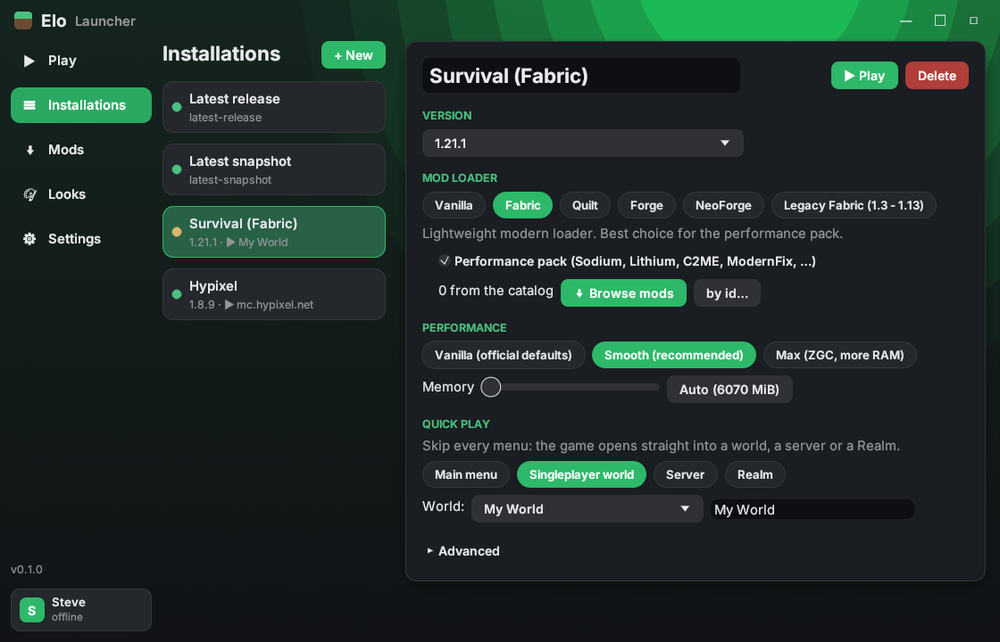
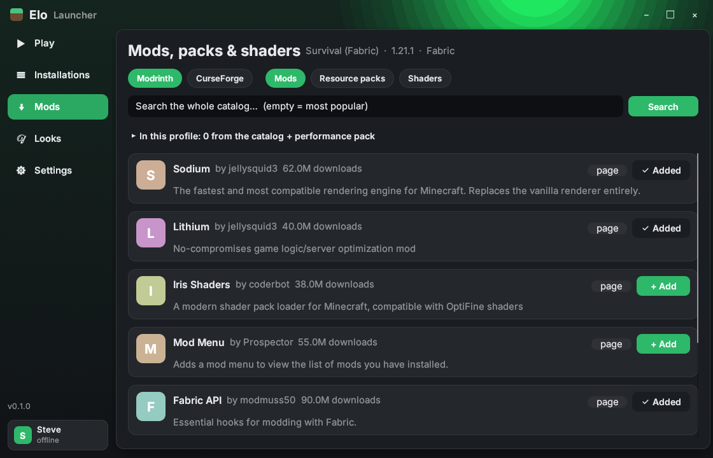
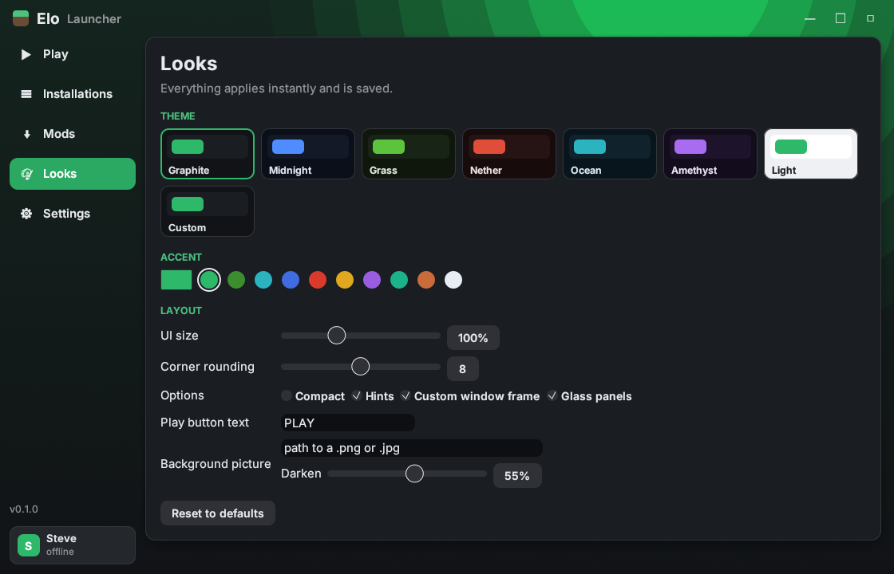

# Elo Launcher

A fast, open-source Minecraft launcher written in Rust.


| Installations | Mods | Looks |
| --- | --- | --- |
|  |  |  |

It uses the same `.minecraft` folder and the same `launcher_profiles.json` as
the official launcher, so your worlds, servers, resource packs and profiles
are picked up unchanged. Switching back is a one-click affair.

## What it does

- **Opens instantly.** A native window, no web view. First frame is drawn in a
  few milliseconds; the version list comes from a disk cache and refreshes in
  the background.
- **Starts the game in well under a second.** Once a version is installed, a
  launch only compares file sizes (no re-hashing), builds the command line and
  starts Java. In the test suite a warm launch takes about 100 ms, a cold
  install-and-launch of a small version about 300 ms (excluding downloads).
- **Smooth frame rate.** Every profile has a performance preset:
  - *Smooth* (default): fixed heap, low-pause G1 tuning, automatic memory
    sizing based on your RAM, JVM class-data-sharing archive for faster JVM
    start-up.
  - *Max*: generational ZGC on Java 21+ for the fewest stutters, bigger heap.
  - *Vanilla*: exactly what the official launcher passes.
- **Every mod loader.** Vanilla, Fabric, Quilt, Forge, NeoForge and Legacy
  Fabric (Fabric for 1.3 to 1.13), selectable per profile. Fabric, Quilt and
  Legacy Fabric install from their meta servers in a fraction of a second;
  Forge and NeoForge are installed by running their official installers
  headlessly, exactly as the Forge documentation recommends. The latest
  stable or recommended loader build is picked automatically, or pin one.
- **Performance pack.** Pick any modded loader and the launcher installs a
  curated set of client-side performance mods from Modrinth: Sodium, Lithium,
  FerriteCore, ImmediatelyFast, Entity Culling, ModernFix, Dynamic FPS,
  Krypton and C2ME. These are what make a big difference: higher and
  steadier FPS, much faster game start-up (ModernFix), faster chunk loading
  so worlds open quicker (C2ME), quicker server joins (Krypton). No gameplay
  changes. Mods that have no build for the chosen loader and version are
  skipped automatically.
- **Quick Play: straight into a world or server.** A profile can be set to
  skip all menus and open a singleplayer world, join a server, or join a Realm
  the moment the game starts (Minecraft 1.20+ Quick Play; older versions fall
  back to the classic `--server` argument for servers).
- **Every version.** Releases, snapshots, old betas and alphas from Mojang's
  manifest, plus any custom version folder you drop in `versions/` (Forge,
  NeoForge, OptiFine, ...). The right Java is downloaded automatically from
  Mojang's runtime catalogue, the same way the official launcher does it.
- **The whole mod catalog.** A built-in browser searches all of Modrinth
  (mods, resource packs and shaders) filtered to the profile's version and
  loader, and CurseForge too once you paste a free API key. One click adds a
  project to the profile; required dependencies come along automatically and
  files are kept up to date on every launch.
- **Looks the way you want.** A navigation rail with Play, Installations,
  Mods, Looks and Settings pages, a hero Play page, Inter typography, soft
  shadows, hover animations and a custom window frame. Eight themes
  (Graphite, Midnight, Grass, Nether, Ocean, Amethyst, Light, Custom with your
  own colours), any accent colour, UI size, corner rounding, compact mode, a
  background picture with adjustable darkening and glass panels, your own
  text on the Play button. Everything applies live and is saved.
- **Profiles.** Name, version, loader, preset, memory, Quick Play target,
  game directory, Java path, extra JVM arguments, window size, extra mods.
- **Accounts.** Microsoft sign-in (device-code flow, token refresh) and
  offline accounts.
- **Usable from the command line** for scripts and shortcuts, e.g. a desktop
  shortcut that opens your survival world directly.

### What a launcher cannot do

Minecraft itself still has to load. A launcher cannot make the JVM, the game
and your mods initialise in under a second; on a decent PC vanilla 1.21 takes
roughly 10 to 20 seconds to reach the title screen and the performance pack
roughly halves that. What this launcher guarantees is that *its own* part is
near zero and that the game starts with the best known settings and goes
straight to where you want to be.

## Install

Grab a build from the Releases page (Windows, macOS Apple Silicon and Intel,
Linux), put it anywhere and run it. There is nothing to install and it never
touches your game files except through the normal game folder. Or build it
yourself:

```sh
cargo build --release
# binary: target/release/elo
```

Building needs only a Rust toolchain. A CLI-only build without the GUI is
available with `cargo build --release --no-default-features`.

Running `elo` without arguments opens the GUI.

## Mods from Modrinth and CurseForge

Pick a mod loader for the installation, then open **Mods** in the navigation
rail (or press *Browse mods* next to the loader). The browser lists the most popular projects for that version and
loader; type to search the whole catalog. Switch between *Mods*, *Resource
packs* and *Shaders*, and between *Modrinth* and *CurseForge*. **Add** puts a
project on the profile; files download on the next Play or with *Download
now*. Dependencies are resolved automatically. Removing a project also deletes
its file.

CurseForge requires an API key, which is free: create one at
https://console.curseforge.com (API keys), then paste it under *Settings →
CurseForge API key*, or run `elo settings curseforge_api_key=...`. Some
authors opt out of third-party downloads on CurseForge; Elo falls back to
the CDN path for those files.

From the command line:

```sh
elo search sodium --version 1.21.1 --loader fabric
elo search --kind shader --version 1.21.1          # most popular shaders
elo search jei --loader forge --curseforge
elo mods Survival iris curseforge:mod:238222       # add by reference
```

References are Modrinth slugs (`sodium`), or `modrinth:shader:<slug>`,
`modrinth:resourcepack:<slug>`, `curseforge:mod:<id>`, and so on.

## Looks

The **Looks** page. Themes with live previews, accent colour (with
Minecraft-flavoured presets), UI size, rounding, compact layout, hints, the
custom window frame, Play button text, background picture with darkening and
glass panels. The *Custom* theme exposes background, panel and text colours. Settings live in
`elo/settings.json` inside the game folder.

## Mod loaders

| Loader | Versions | How it is installed |
| --- | --- | --- |
| Fabric | 1.14+ | meta.fabricmc.net profile JSON |
| Quilt | 1.14+ | meta.quiltmc.org profile JSON; runs Fabric mods too |
| Legacy Fabric | 1.3 to 1.13 | meta.legacyfabric.net profile JSON |
| Forge | 1.12.2+ (new-style installers) | official installer, `--installClient` |
| NeoForge | 1.20.2+ | official installer, `--installClient` |

For Forge versions older than 1.12.2 run the Forge installer yourself once;
the resulting version folder shows up under *Installed custom versions* in
the version picker. The same works for OptiFine, or anything else that drops
a folder into `versions/`.

## Microsoft login

Microsoft requires every third-party launcher to use its own Azure
application id, approved for the Minecraft API. Mojang does not allow shipping
someone else's id.

**If you downloaded a release build** that was published with an approved id,
sign-in just works: *Accounts → Sign in with Microsoft*.

**If you build it yourself**, or no id was baked in, do the one-time setup:

1. Create an app registration in the Azure portal (any personal Microsoft
   account works). Supported account types: *Personal Microsoft accounts
   only*. Under *Authentication*, enable *Allow public client flows*.
2. Request Minecraft API access for that application id via Mojang's form
   (search for "Minecraft API and Azure Application ID form").
3. Put the client id in the launcher: *Settings → Microsoft client id*, or
   `elo settings msa_client_id=<id>`, or the environment variable
   `MC_LAUNCHER_MSA_CLIENT_ID`.

Then *Accounts → Sign in with Microsoft*. A code is shown and your browser
opens; enter the code and sign in. Tokens are refreshed automatically.

**Publishing builds for other people:** add your approved id as the GitHub
repository secret `MSA_CLIENT_ID`. The release workflow compiles it into the
binaries (`MC_LAUNCHER_DEFAULT_CLIENT_ID` at build time), so your users never
see this section. Settings and the environment variable still override it.

Offline accounts (no purchase check) work in singleplayer and on servers with
`online-mode=false`.

## Command line

```text
elo                      open the GUI
elo versions [-s] [-a]   list versions (snapshots / all)
elo install 1.21.1 [--loader fabric|quilt|forge|neoforge|legacyfabric]
elo login [--offline NAME]
elo profile add "Survival" --version 1.21.1 --loader fabric --world "My World"
elo profile add "Packs" --version 1.20.1 --loader forge --no-perf-mods
elo profile add "Hypixel" --version 1.8.9 --server mc.hypixel.net --preset max
elo profile list | set | remove | select
elo launch [PROFILE] [--world W | --server HOST[:PORT] | --realm ID]
                  [--version V] [--loader L] [--offline NAME] [--preset vanilla|smooth|max]
                  [--memory MiB] [--dry-run] [--detach]
elo worlds [PROFILE]     list worlds and saved servers for Quick Play
elo mods PROFILE [slugs] install Modrinth mods into a modded profile
elo java                 show detected Java installations
elo settings [key=value]
```

Examples:

```sh
# Straight into a world with the performance pack, no questions asked
elo launch Survival --world "My World"

# A one-off launch of a snapshot on an offline account
elo launch --version 24w14a --offline Steve

# Add shaders on top of the performance pack
elo mods Survival iris
```

Environment variables: `MC_LAUNCHER_ROOT` overrides the game directory;
`HTTPS_PROXY` is honoured for downloads.

## How the speed is achieved

| Step | Official launcher | This launcher |
| --- | --- | --- |
| Window | Web view, several seconds | Native egui window, first frame in milliseconds |
| Version list | Fetched on start | Disk cache, refreshed in the background |
| File check on Play | Re-reads metadata and often re-hashes | Size compare only; hashing is opt-in (*Settings → Verify every file*) |
| Java detection | `java -version` each time | Cached per binary (invalidated when it changes) |
| Downloads | Sequential-ish | 32 parallel connections with keep-alive and SHA-1 verification |
| JVM start | Default | Class-data-sharing archive per version (Java 19+), fixed heap |
| Game start | Default | ModernFix, Sodium and friends via the performance pack |
| Reaching your world | Click through menus | Quick Play argument on the command line |

## Layout on disk

Everything lives in the normal game directory (`%APPDATA%\.minecraft`,
`~/Library/Application Support/minecraft`, `~/.minecraft`):

- `launcher_profiles.json`: shared with the official launcher.
- `elo/`: Elo's own state (settings, accounts, per-profile extras,
  caches, CDS archives). Delete it to reset the launcher without touching the
  game.
- `.elo_mods.json` in a game directory: which mod/pack/shader files Elo
  manages there.
- `versions/`, `libraries/`, `assets/`, `runtime/`: identical layout to the
  official launcher.

## Development

```sh
cargo test                       # unit tests + end-to-end test
cargo test --no-default-features # same, without compiling the GUI
cargo clippy --all-targets
```

The end-to-end test starts a local mock of Mojang's, Fabric's, Quilt's,
Forge's and Modrinth's servers plus tiny stand-in Minecraft and Forge
installer jars, then drives the real binary through install, Quick Play,
every loader and a network-free warm start. It needs a `java` on the `PATH`
and skips itself otherwise.

To publish a release: merge to `main`, then push a tag such as `v0.1.0`. The
workflow builds all four binaries and attaches them to a GitHub Release.

## License

MIT, see `LICENSE`. The Inter font in `assets/fonts` is used under the SIL
Open Font License 1.1 (see `assets/fonts/LICENSE.txt`). Minecraft is a trademark of Mojang AB; this project is not
affiliated with Mojang or Microsoft.
